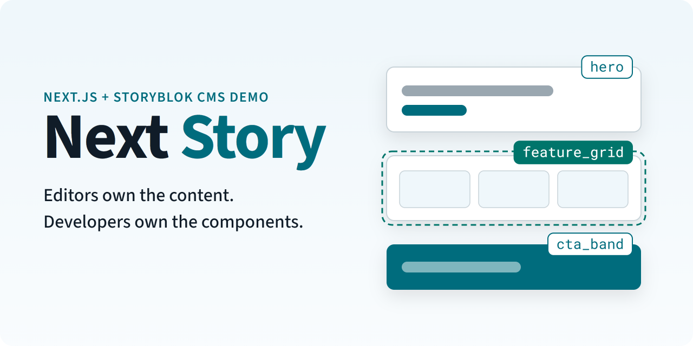

<p align="center">
  <a href="https://nextstory.marcopontili.com">
    <picture>
      <source media="(prefers-color-scheme: dark)" srcset=".github/brand/readme-dark-rounded.svg" />
      
    </picture>
  </a>
</p>

# Next Story

[](https://github.com/marcop135/nextstory/actions/workflows/ci.yml)
[](https://github.com/marcop135/nextstory/releases/latest)
[](./LICENSE)
[](https://nodejs.org/)
[](https://nextjs.org/)
[](https://react.dev/)
[](https://www.storyblok.com/)

**A marketing site is more than its pages.** Next Story is a [Next.js](https://nextjs.org/) and [Storyblok](https://www.storyblok.com/) demo that runs what turns a visit into a lead, in public: campaigns, consent, attribution, preview, caching, and releases.

Every page shows one part working and links to its code. **Marketers** build pages and campaigns from blocks in Storyblok; **developers** own the blocks, the lead pipeline, and the guardrails.

## Features

- Pages and campaigns from shared Storyblok blocks, previewed as drafts before publish
- One `campaign_id` from Storyblok to the HubSpot contact and the Matomo event
- Leads checked on the server: same origin, published campaign only, honeypot, rate limit, Turnstile
- English and German at field level
- Publish webhooks refresh only the changed pages
- Cookieless Matomo analytics
- Every page links to the code behind it
- Read-only agent access: Markdown pages, block catalog, API catalog, OpenAPI, agent skills

## Explore the demo

Live demo: **[nextstory.marcopontili.com](https://nextstory.marcopontili.com)**

| Page | What it shows |
| --- | --- |
| [Home](https://nextstory.marcopontili.com/) | Editor and developer responsibilities |
| [How it works](https://nextstory.marcopontili.com/how-it-works) | Edit-to-publish workflow linked to source |
| [Blocks](https://nextstory.marcopontili.com/blocks) | Block examples with component labels |
| [Campaign workshop](https://nextstory.marcopontili.com/campaign-workshop) | Pick features, save a draft the server reads later, and submit a lead |
| [Deutsch](https://nextstory.marcopontili.com/de) | Field-level German translations |
| [For agents](https://nextstory.marcopontili.com/for-agents) | Published Markdown, block catalog, read-only tools |

## How content flows

<picture>
  <source media="(prefers-color-scheme: dark)" srcset="docs/content-flow-dark.svg" />
  
</picture>

See [Architecture](docs/architecture.md) for request flows.

[Content schema](docs/storyblok-schema.md) · [Commands](docs/commands.md) · [Development cycle](docs/development-cycle.md)

## Tech stack

| Layer | Tools |
| --- | --- |
| Language | TypeScript 5 |
| Framework | Next.js 16 App Router, React 19 |
| Styling | Plain CSS |
| Content | Storyblok headless CMS via `@storyblok/react`, English and German |
| Leads | HubSpot Forms API v3, Cloudflare Turnstile bot check |
| Quality | Vitest, Playwright, ESLint, TypeScript |
| Analytics | Matomo through Tag Manager, cookieless |
| Hosting | Vercel |
| CI | GitHub Actions, Dependabot |

## Quick start

Requires Node.js 22+.

```bash
npm install
cp .env.example .env
npm run dev
```

Open http://localhost:3000. Without a Storyblok delivery token, bundled English/German stories run locally.

Run `npm test` for CMS workflows.

Against a running build:

- `npm run smoke`: page journeys, links, and sitemap.
- `npm run verify:agent-readiness`: public resources and read-only tools.
- `npm run verify:browser`: motion, navigation, and responsive screenshots.

## Agent skills

Markdown skills for Claude Code, Cursor, and Codex ship in the repo and load when you open the clone. Each one points an agent at the right how-to and the checks CI runs.

[Agent skills docs](docs/agent-skills.md)

Three read-only workflows for visitors and remote agents live at [`/.well-known/agent-skills/index.json`](https://nextstory.marcopontili.com/.well-known/agent-skills/index.json): read a German page, inspect the block model, and trace a block to code. No API key is required.

[For agents](https://nextstory.marcopontili.com/for-agents) lists the same workflows and every public resource.

## Storyblok setup

Create a space, enable German (`de`), and follow [own-space setup](docs/commands.md#storyblok) for imports, preview, and webhooks. Imports save drafts; replacements require a reviewed snapshot.

All variables are optional in local mode. Set them in `.env` for CMS mode:

| Variable | Required for | Purpose / default |
| --- | --- | --- |
| `STORYBLOK_DELIVERY_API_TOKEN` | CMS content | Server-only preview token for draft and published content |
| `STORYBLOK_REGION` | Non-EU spaces | Space region; defaults to `eu` |
| `STORYBLOK_VERSION` | Optional | Local delivery version; defaults to `draft`. Production uses `published` outside preview |
| `STORYBLOK_PREVIEW_SECRET` | Draft preview | Authenticates `/api/preview` |
| `STORYBLOK_REVALIDATE_SECRET` | Publish webhooks | Authenticates `/api/revalidate` |
| `STORYBLOK_PERSONAL_ACCESS_TOKEN`, `STORYBLOK_SPACE_ID` | Schema/story import | Management API credentials for `storyblok:push` only |

## Contributing

Found a bug or have an idea? Open an [issue](https://github.com/marcop135/nextstory/issues), or read [CONTRIBUTING.md](./CONTRIBUTING.md) before a pull request. To report a vulnerability, use [SECURITY.md](./SECURITY.md) instead of a public issue.

## Related

[Next Fold](https://github.com/marcop135/nextfold) is the Sanity counterpart: typed page sections, an embedded Studio, and GROQ queries.

## Author

[Marco Pontili](https://marcopontili.com)

## License

[MIT](./LICENSE)
