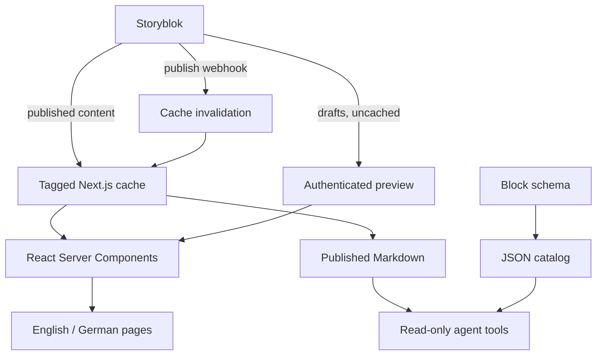

<p align="center">
  <a href="https://nextstory.marcopontili.com">
    <picture>
      <source media="(prefers-color-scheme: dark)" srcset=".github/brand/readme-dark.png" />
      
    </picture>
  </a>
</p>

# Next Story

Next Story is a headless CMS demo built with [Next.js](https://nextjs.org/) App Router and [Storyblok](https://www.storyblok.com/). I keep it as a public learning project: each feature on the live site links back to the code behind it, from content modeling and draft preview to German routes, cache invalidation, and read-only access for agents.

[](https://github.com/marcop135/nextstory/actions/workflows/ci.yml)
[](https://github.com/marcop135/nextstory/releases/latest)
[](./LICENSE)
[](https://nodejs.org/)
[](https://nextjs.org/)
[](https://react.dev/)
[](https://www.typescriptlang.org/)
[](https://www.storyblok.com/)

## Explore the demo

Live demo: **[nextstory.marcopontili.com](https://nextstory.marcopontili.com)**

| Page | What it shows |
| --- | --- |
| [Home](https://nextstory.marcopontili.com/) | How a page goes from edit to publish, and which parts editors and developers own |
| [How it works](https://nextstory.marcopontili.com/how-it-works) | The path from a Storyblok edit to the live page, each step linked to its source |
| [Blocks](https://nextstory.marcopontili.com/blocks) | Every block once; a toggle labels each one with its component name |
| [Deutsch](https://nextstory.marcopontili.com/de) | The same stories in German through field-level translations |
| [For agents](https://nextstory.marcopontili.com/for-agents) | Published pages as Markdown, the block catalog, and read-only tools |

## Tech stack

- Next.js 16 App Router, React 19 Server Components, and TypeScript
- Storyblok headless CMS with `@storyblok/react`
- CSS custom properties with system light and dark themes

## How content flows



The Visual Editor bridge runs in authenticated preview. Public Markdown always reads published content. See [Architecture](docs/architecture.md) for request flows.

## Source files by feature

| Feature | Source |
| --- | --- |
| Content schema and generated types | [`storyblok/components.json`](storyblok/components.json), [`scripts/storyblok-types.mjs`](scripts/storyblok-types.mjs) |
| CMS blocks and React Server Components | [`src/lib/storyblok.ts`](src/lib/storyblok.ts), [`src/components/`](src/components/) |
| Draft preview and webhook revalidation | [`preview/route.ts`](src/app/api/preview/route.ts), [`revalidate/route.ts`](src/app/api/revalidate/route.ts) |
| Global navigation and footer | [`src/lib/site-config.ts`](src/lib/site-config.ts), [`src/components/SiteChrome.tsx`](src/components/SiteChrome.tsx) |
| Referenced learning notes | [`src/lib/related-content.ts`](src/lib/related-content.ts), [`src/components/RelatedContent.tsx`](src/components/RelatedContent.tsx) |
| Localization and language routing | [`src/lib/i18n.ts`](src/lib/i18n.ts), [`src/proxy.ts`](src/proxy.ts) |
| Offline development with seed stories | [`src/lib/mock-story.ts`](src/lib/mock-story.ts) |
| Published content as Markdown | [`src/lib/story-markdown.ts`](src/lib/story-markdown.ts) |
| Read-only agent resources and tools | [`src/lib/agent-resources.ts`](src/lib/agent-resources.ts), [`src/lib/agent-tools.ts`](src/lib/agent-tools.ts) |

Further documentation: [Architecture](docs/architecture.md) · [Content schema](docs/storyblok-schema.md) · [Commands](docs/commands.md) · [Development cycle](docs/development-cycle.md)

## Quick start

Requires Node.js 22+ and npm.

```bash
npm install
cp .env.example .env
npm run dev
```

Open http://localhost:3000. **Local mode:** leave the delivery token empty to render bundled seed stories in English and German (`source: mock`), without a Storyblok account. **Storyblok mode:** connect your own space using the setup below (`source: storyblok`).

`npm test` covers rendering, translations, delivery, preview, webhooks, Markdown, imports, and tool lifecycle. Against a running build, `npm run smoke` checks journeys, `npm run verify:agent-readiness` checks public resources, and `npm run verify:browser` checks motion/navigation in system Chrome and saves responsive screenshots.

## Storyblok setup

Create a space, enable German (`de`), then import tracked components and seed stories with `npm run storyblok:push -- --bootstrap`. Imports save drafts; `--publish` explicitly publishes. Existing content replacements require a reviewed remote snapshot as their baseline. Follow [own-space setup](docs/commands.md#storyblok) for tokens, scoped updates, Visual Editor configuration, and webhooks.

All variables are optional in local mode. Set them in `.env` for CMS mode:

| Variable | Required for | Purpose / default |
| --- | --- | --- |
| `STORYBLOK_DELIVERY_API_TOKEN` | CMS content | Server-only preview token for draft and published content |
| `STORYBLOK_REGION` | Non-EU spaces | Space region; defaults to `eu` |
| `STORYBLOK_VERSION` | Optional | Local delivery version; defaults to `draft`. Production uses `published` outside preview |
| `STORYBLOK_PREVIEW_SECRET` | Draft preview | Authenticates `/api/preview` |
| `STORYBLOK_REVALIDATE_SECRET` | Publish webhooks | Authenticates `/api/revalidate` |
| `STORYBLOK_PERSONAL_ACCESS_TOKEN`, `STORYBLOK_SPACE_ID` | Schema/story import | Management API credentials for `storyblok:push` only |

## Contributing

See [CONTRIBUTING.md](./CONTRIBUTING.md).

Bug reports and feature requests go through [issues](https://github.com/marcop135/nextstory/issues). Vulnerabilities go through [SECURITY.md](./SECURITY.md) instead.

## Author

[Marco Pontili](https://marcopontili.com)

## License

[MIT](./LICENSE)
