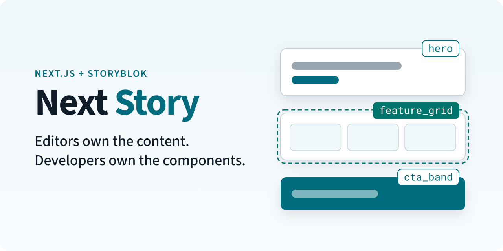

<p align="center">
  <a href="https://nextstory.marcopontili.com">
    <picture>
      <source media="(prefers-color-scheme: dark)" srcset=".github/brand/readme-dark-rounded.svg" />
      
    </picture>
  </a>
</p>

# Next Story

A [Next.js](https://nextjs.org/) App Router and [Storyblok](https://www.storyblok.com/) learning project. Explore content modeling, draft preview, localization, caching, and read-only agent access, with each feature linked to its source.

[](https://github.com/marcop135/nextstory/actions/workflows/ci.yml)
[](https://github.com/marcop135/nextstory/releases/latest)
[](./LICENSE)
[](https://nodejs.org/)
[](https://nextjs.org/)
[](https://react.dev/)
[](https://www.typescriptlang.org/)
[](https://www.storyblok.com/)

## Explore the demo

Live demo: **[nextstory.marcopontili.com](https://nextstory.marcopontili.com)**

| Page | What it shows |
| --- | --- |
| [Home](https://nextstory.marcopontili.com/) | Editor and developer responsibilities |
| [How it works](https://nextstory.marcopontili.com/how-it-works) | Edit-to-publish workflow linked to source |
| [Blocks](https://nextstory.marcopontili.com/blocks) | Block examples with component labels |
| [Deutsch](https://nextstory.marcopontili.com/de) | Field-level German translations |
| [For agents](https://nextstory.marcopontili.com/for-agents) | Published Markdown, block catalog, read-only tools |

## How content flows

<picture>
  <source media="(prefers-color-scheme: dark)" srcset="docs/content-flow-dark.svg" />
  
</picture>

See [Architecture](docs/architecture.md) for request flows.

## Source files by feature

| Feature | Source |
| --- | --- |
| Schema and types | [`storyblok/components.json`](storyblok/components.json), [`scripts/storyblok-types.mjs`](scripts/storyblok-types.mjs) |
| CMS blocks | [`src/lib/storyblok.ts`](src/lib/storyblok.ts), [`src/components/`](src/components/) |
| Preview and revalidation | [`preview/route.ts`](src/app/api/preview/route.ts), [`revalidate/route.ts`](src/app/api/revalidate/route.ts) |
| Navigation and footer | [`src/lib/site-config.ts`](src/lib/site-config.ts), [`src/components/SiteChrome.tsx`](src/components/SiteChrome.tsx) |
| Related notes | [`src/lib/related-content.ts`](src/lib/related-content.ts), [`src/components/RelatedContent.tsx`](src/components/RelatedContent.tsx) |
| Localization | [`src/lib/i18n.ts`](src/lib/i18n.ts), [`src/proxy.ts`](src/proxy.ts) |
| Seed stories | [`src/lib/mock-story.ts`](src/lib/mock-story.ts) |
| Published Markdown | [`src/lib/story-markdown.ts`](src/lib/story-markdown.ts) |
| Campaign to lead | [`lead/route.ts`](src/app/api/lead/route.ts), [`CampaignAction.tsx`](src/components/CampaignAction.tsx), [`agent-tools.ts`](src/lib/agent-tools.ts) (`get_campaign_brief`), [flow](docs/architecture.md#campaign-to-lead) |
| Read-only agent access | [`src/lib/agent-resources.ts`](src/lib/agent-resources.ts), [`src/lib/agent-tools.ts`](src/lib/agent-tools.ts) |

[Content schema](docs/storyblok-schema.md) · [Commands](docs/commands.md) · [Development cycle](docs/development-cycle.md)

## Quick start

Requires Node.js 22+.

```bash
npm install
cp .env.example .env
npm run dev
```

Open http://localhost:3000. Without a Storyblok delivery token, bundled English/German stories run locally.

Run `npm test` for CMS workflows.

Against a running build:

- `npm run smoke`: page journeys, links, and sitemap.
- `npm run verify:agent-readiness`: public resources and read-only tools.
- `npm run verify:browser`: motion, navigation, and responsive screenshots.

## Storyblok setup

Create a space, enable German (`de`), and follow [own-space setup](docs/commands.md#storyblok) for imports, preview, and webhooks. Imports save drafts; replacements require a reviewed snapshot.

All variables are optional in local mode. Set them in `.env` for CMS mode:

| Variable | Required for | Purpose / default |
| --- | --- | --- |
| `STORYBLOK_DELIVERY_API_TOKEN` | CMS content | Server-only preview token for draft and published content |
| `STORYBLOK_REGION` | Non-EU spaces | Space region; defaults to `eu` |
| `STORYBLOK_VERSION` | Optional | Local delivery version; defaults to `draft`. Production uses `published` outside preview |
| `STORYBLOK_PREVIEW_SECRET` | Draft preview | Authenticates `/api/preview` |
| `STORYBLOK_REVALIDATE_SECRET` | Publish webhooks | Authenticates `/api/revalidate` |
| `STORYBLOK_PERSONAL_ACCESS_TOKEN`, `STORYBLOK_SPACE_ID` | Schema/story import | Management API credentials for `storyblok:push` only |

## Contributing

See [CONTRIBUTING.md](./CONTRIBUTING.md).

Bug reports and feature requests go through [issues](https://github.com/marcop135/nextstory/issues). Vulnerabilities go through [SECURITY.md](./SECURITY.md) instead.

## Author

[Marco Pontili](https://marcopontili.com)

## License

[MIT](./LICENSE)
