<p align="center">
  <a href="https://nextstory.marcopontili.com">
    <picture>
      <source media="(prefers-color-scheme: dark)" srcset=".github/brand/readme-dark-rounded.svg" />
      
    </picture>
  </a>
</p>

# Next Story

[](https://github.com/marcop135/nextstory/actions/workflows/ci.yml)
[](https://github.com/marcop135/nextstory/releases/latest)
[](./LICENSE)
[](https://nodejs.org/)
[](https://nextjs.org/)
[](https://react.dev/)
[](https://www.storyblok.com/)

**A marketing site is more than its pages.** Next Story is a [Next.js](https://nextjs.org/) and [Storyblok](https://www.storyblok.com/) [live demo](https://nextstory.marcopontili.com) that runs what turns a visit into a lead, in public: campaigns, consent, attribution, preview, caching, and releases.

Every page shows one part working and links to its code. **Marketers** build pages and campaigns from blocks in Storyblok; **developers** own the blocks, the lead pipeline, and the guardrails.

## Features

- Shared page and campaign blocks with draft preview
- Lead checks: same origin, published campaign, honeypot, rate limits, Turnstile
- One `campaign_id` from Storyblok through HubSpot and Matomo
- Publish webhooks refresh only changed pages
- Field-level English and German
- Cookieless Matomo analytics
- Source links on every page to trace the working example
- Read-only Markdown, catalogs, OpenAPI, and agent skills

## Explore the demo

Live demo: **[nextstory.marcopontili.com](https://nextstory.marcopontili.com)**

| Page | What you can do |
| --- | --- |
| [Home](https://nextstory.marcopontili.com/) | Compare editor and developer responsibilities |
| [How it works](https://nextstory.marcopontili.com/how-it-works) | Reorder a draft and publish it to a local preview |
| [Blocks](https://nextstory.marcopontili.com/blocks) | Inspect required fields and English/German values |
| [Campaign workshop](https://nextstory.marcopontili.com/campaign-workshop) | Inspect attribution, pick features, save a draft, and submit a lead |
| [Cache invalidation](https://nextstory.marcopontili.com/cache-invalidation) | Compare HEAD request timings and response headers |
| [Content relationships](https://nextstory.marcopontili.com/content-relationships) | Trace a shared learning note to its referring pages |
| [Deutsch](https://nextstory.marcopontili.com/de) | Read the same pages in German |
| [For agents](https://nextstory.marcopontili.com/for-agents) | Read published Markdown, inspect the block catalog, and trace source links |

## How content flows

<picture>
  <source media="(prefers-color-scheme: dark)" srcset="docs/diagrams/content-flow-dark.svg" />
  
</picture>

See [Architecture](docs/architecture.md) for request flows.

[Content model](docs/storyblok-schema.md) · [Setup and commands](docs/commands.md) · [Development cycle](docs/development-cycle.md)

## Tech stack

| Area | Technology |
| --- | --- |
| Language | TypeScript 5 |
| Framework | Next.js 16, App Router |
| UI library | React 19 |
| Styling | Plain CSS with cascade layers |
| CMS | Storyblok, Visual Editor |
| Leads | HubSpot, Turnstile |
| Localization | Field-level English and German |
| Caching | Tagged fetch cache, expired on publish |
| Testing | Vitest, Playwright, axe accessibility checks |
| Code quality | ESLint, Storyblok types, Dependabot |
| CI | GitHub Actions |
| Security | Security headers, CodeQL, OpenSSF Scorecard |
| Analytics | Self-hosted Matomo, cookieless |
| Hosting | Vercel |
| DNS | Cloudflare |

## Quick start

Requires Node.js 22+.

```bash
npm install
cp .env.example .env
npm run dev
```

Open http://localhost:3000. Without a Storyblok delivery token, bundled English/German stories run locally.

Run `npm test` for CMS workflows.

Against a running build:

- `npm run smoke`: page journeys, links, and sitemap.
- `npm run verify:agent-readiness`: public resources and read-only tools.
- `npm run verify:browser`: motion, navigation, and responsive screenshots.

## Agent skills

Four shared coding skills and three public, read-only workflows. See the [agent skills guide](docs/agent-skills.md).

## Storyblok setup

Create a space, enable German (`de`), then follow [own-space setup](docs/commands.md#storyblok). Variables are optional locally; set them in `.env` for CMS mode:

| Variable | Required for | Purpose / default |
| --- | --- | --- |
| `STORYBLOK_DELIVERY_API_TOKEN` | CMS content | Server-only preview token for draft and published content |
| `STORYBLOK_REGION` | Non-EU spaces | Space region; defaults to `eu` |
| `STORYBLOK_VERSION` | Optional | Local delivery version; defaults to `draft`. Production uses `published` outside preview |
| `STORYBLOK_PREVIEW_SECRET` | Draft preview | Authenticates `/api/preview` |
| `STORYBLOK_REVALIDATE_SECRET` | Publish webhooks | Authenticates `/api/revalidate` |
| `STORYBLOK_PERSONAL_ACCESS_TOKEN`, `STORYBLOK_SPACE_ID` | Schema/story import | Management API credentials for `storyblok:push` only |

## Next Fold

Next Fold is the Sanity counterpart of this Storyblok demo: same Next.js App Router approach with a different headless CMS. See [Next Fold](https://nextfold.marcopontili.com).

## Contributing

Report bugs or propose features through [Issues](https://github.com/marcop135/nextstory/issues/new/choose). For code or documentation changes, follow the [contributing guide](CONTRIBUTING.md) for local setup, checks, and pull requests.

Report vulnerabilities privately using the [security policy](SECURITY.md), not a public issue.

## Author

[Marco Pontili](https://marcopontili.com)

## License

[MIT](./LICENSE)
