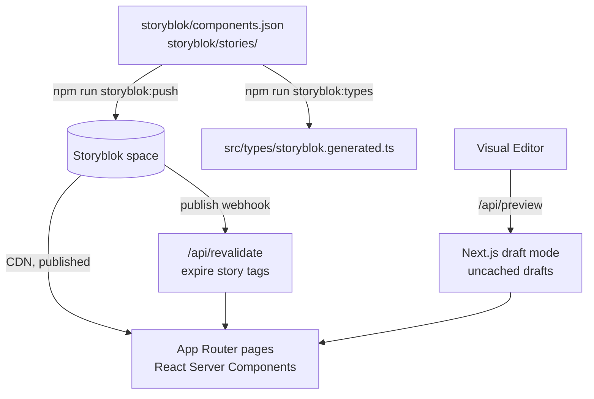

# Architecture

Next Story is a headless CMS demo built with Next.js and Storyblok. Storyblok owns page content; React Server Components define how blocks render.

## Request path

1. [`src/proxy.ts`](../src/proxy.ts) sets an `x-site-locale` request header from the first path segment. The root layout reads it for `<html lang>`, the German navigation, and JSON-LD.
2. [`src/app/[[...slug]]/page.tsx`](../src/app/[[...slug]]/page.tsx) parses locale and slug (`/`, `/pricing`, `/de`, `/de/pricing`). The `config` story returns 404 as a page.
3. [`src/lib/fetch-story.ts`](../src/lib/fetch-story.ts) loads from the CDN when a token is configured; otherwise the seed stories in `storyblok/stories/` render, translated by [`src/lib/localize.ts`](../src/lib/localize.ts) the same way the CDN resolves `language=de`. Production always requests published content unless draft mode is enabled. Drafts bypass the cache; published fetches share collection and per-story tags across languages, with a 60-second fallback expiry. Missing stories return 404; upstream failures surface as errors, not missing pages.
4. [`src/components/StoryRenderer.tsx`](../src/components/StoryRenderer.tsx) registers blocks on the server. Public stories render through `StoryblokServerComponent`, bypassing the SDK's process-wide editor cache. Authenticated preview uses `StoryblokStory`, which mounts the Visual Editor bridge once. The delivery token stays on the server. The hero's HTML/SVG illustration uses a small client boundary to start CSS motion at 25% viewport intersection, pause offscreen or on tab-visibility events, and finish once. Reduced motion and JavaScript-disabled requests retain the static final state.
5. [`src/lib/site-config.ts`](../src/lib/site-config.ts) loads the `config` story for header navigation, the footer note, and footer project links. The footer's Explore group reuses header navigation. Missing config uses localized built-in links.
6. [`src/app/api/preview/route.ts`](../src/app/api/preview/route.ts) authenticates, validates the slug and locale, verifies draft content, then enables the cookie. Exit-preview redirects stay on the request origin.
7. [`src/app/api/revalidate/route.ts`](../src/app/api/revalidate/route.ts) accepts publish, unpublish, delete, and move events. Story tags expire immediately in all languages and the sitemap refreshes; move events also expire the old slug; a `config` publish also refreshes the shared layout. Legacy ID-only payloads and moves without an old slug expire the collection and root layout. Invalid JSON or story paths return 400 without cache changes; unrelated actions receive a JSON acknowledgement without invalidation.
8. [`src/lib/related-content.ts`](../src/lib/related-content.ts) keeps ordered UUID references to independent `learning_note` stories. Delivery resolves them in a separate `by_uuids` request with the parent's language and draft/published version. Missing and non-note references are omitted. Published relation requests share `storyblok:related-content`; valid content webhooks expire that tag so reference consumers refresh without expiring unrelated base-story data.
9. [`src/app/sitemap.ts`](../src/app/sitemap.ts) lists published pages and learning notes from the Storyblok Links API in both languages, cached under the collection tag. [`src/app/content/[...slug]/route.ts`](../src/app/content/[...slug]/route.ts) serializes localized content and resolved note links into Markdown, explicitly requesting published delivery. Resource responses are `no-store`, so a second response cache cannot outlive publication invalidation.

## Public reading resources

`/content/index.md` and `/content/de/index.md` represent home; `/content/blocks.md`, `/content/de/blocks.md`, and corresponding story paths return Markdown. Explicit URLs avoid negotiating HTML/RSC and Markdown at the same address. Unknown/private paths return 404; upstream delivery failures return 503. Preview cookies do not change these published representations. HTML metadata advertises Markdown alternates.

[`src/lib/agent-resources.ts`](../src/lib/agent-resources.ts) owns the resource inventory, portal workflows, API catalog, OpenAPI description, and skills index. `/content/blocks.json` derives page-block metadata from the schema, including translation flags and source paths. It does not ship the React registry to browsers. `/auth.md` describes public access and the separate authenticated CMS operations.

[`AgentTools`](../src/components/AgentTools.tsx) mounts once and feature-detects native WebMCP. [`agent-tools.ts`](../src/lib/agent-tools.ts) wraps the same HTTP resources with `get_page_markdown` and `list_blocks`, caps response bytes, forwards cancellation, and aborts registration on unmount. The current pathname is resolved at execution rather than captured before client navigation. Browsers without the API use the public resources directly. Native support and stubbed lifecycle verification are distinct checks.

## Route and delivery boundaries

| Request | Content source | Behavior |
| --- | --- | --- |
| `/`, `/pricing`, `/de/pricing` | CMS with a delivery token; seeds without one | Development defaults to drafts; production defaults to published content |
| Authenticated preview | Draft delivery | Uncached, with the Visual Editor bridge enabled |
| `/config`, `/de/config` | None | Always 404; global configuration is loaded by the layout |
| `/content/index.md`, `/content/de/pricing.md` | Published delivery, or seeds in local mode | Preview cookies cannot expose drafts |
| `/content/blocks.json` | Tracked component schema | Block catalog independent of the current CMS content |
| `/privacy`, `/for-agents` | Application code | Fixed routes, not editable Storyblok stories |

Missing CMS stories do not fall back to seeds. Page delivery errors surface as errors; Markdown returns 503. Global configuration failures retain the built-in shell. The sitemap uses seed slugs on delivery failure, but a successful empty published inventory stays empty.

Production runs on Vercel at `https://nextstory.marcopontili.com`. [Environment configuration](commands.md#environment) separates delivery, import, preview, and webhook credentials; [the development cycle](development-cycle.md#coordinate-storyblok-content) coordinates code deployment with CMS publication.

## Analytics and headers

- [`public/matomo.js`](../public/matomo.js) loads self-hosted, cookieless Matomo (site 5) after hydration; [`MatomoRouteTracker`](../src/components/MatomoRouteTracker.tsx) records client navigations.
- [`src/proxy.ts`](../src/proxy.ts) reports AI-assistant fetches (`ChatGPT-User`, `Claude-User`, and the rest of the marcopontili.com access-log needles) to Matomo with `recMode=1` via `waitUntil`. It never changes the response.
- [`next.config.ts`](../next.config.ts) sets CSP, HSTS, `nosniff`, and Referrer-Policy on every route. `frame-ancestors` allows the Storyblok Visual Editor and `script-src` its bridge script.
